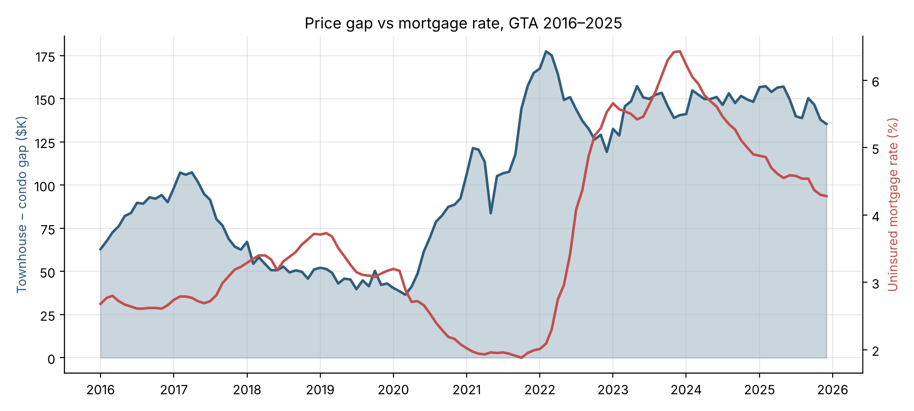
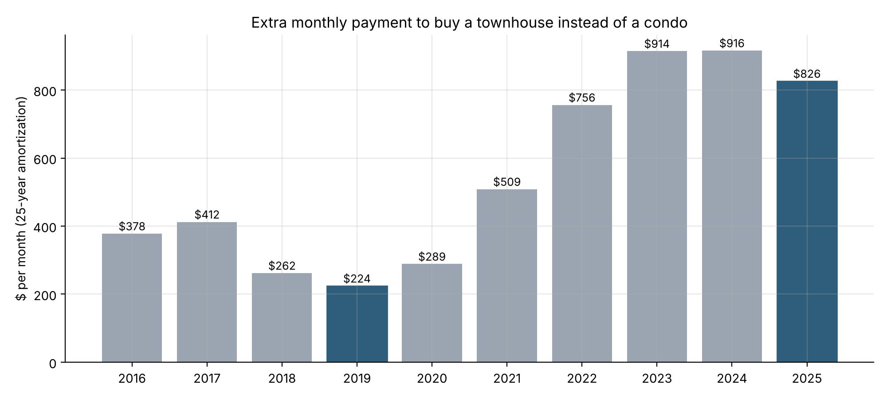
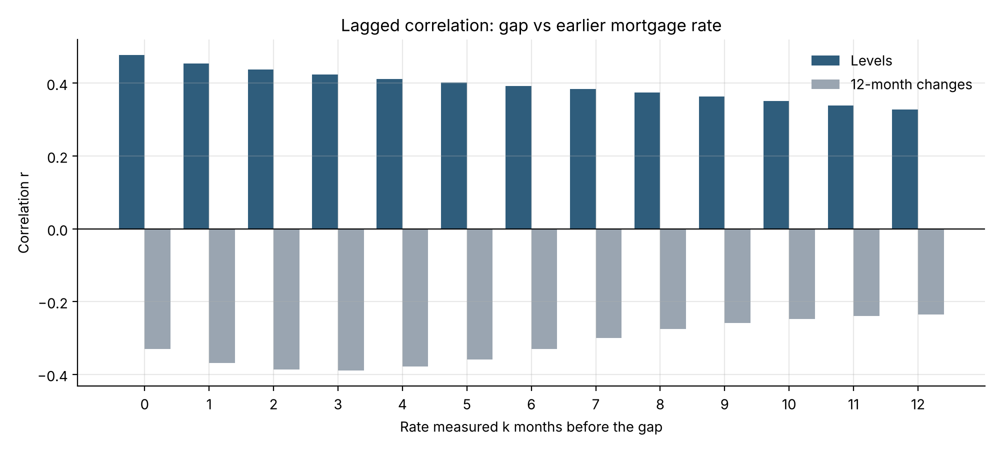

# Do Rising Mortgage Rates Shrink the Townhouse Premium? GTA Housing Analysis (2016–2025)

How much more does a townhouse cost than a condo in the Greater Toronto Area (GTA), and how does that premium move when mortgage rates change?

This project joins 10 years of monthly home prices with Canadian mortgage rates in Python. It measures the townhouse–condo price gap, turns it into a monthly mortgage cost, and tests how the gap responds to rate changes.



## Why it matters

Many GTA buyers choose between a condo and a townhouse. Condo owners who want more space also face a move-up decision. The price gap decides how much extra they must borrow. This analysis helps answer two questions:

- Which property type makes sense when rates change?
- When is a better time for a condo owner to move up to a townhouse?

## Key findings

- **The townhouse premium tripled.** The average gap grew from **$45.7K in 2019 to $148.3K in 2025**. The price ratio went from 1.09 to 1.26.
- **The extra monthly cost rose from about $224 to about $826** (25-year amortization, Canadian semi-annual compounding).
- **The gap tended to narrow when rates rose.** Raw monthly levels show r = +0.48, but that mostly reflects both series being high after 2022. After removing the long-run trend (12-month changes), the correlation is **r = −0.33**.
- **The link is strongest 2–3 months later** (r = −0.39 when the gap is compared with the rate 2–3 months earlier).
- **The biggest jump came in the low-rate COVID period.** From March 2020 to February 2022, the gap grew by **$140.9K**. Record-low rates overlapped with COVID effects such as people moving out of the city and construction that started before COVID, so the two cannot be separated with this data.
- **Mortgage rates are a key factor, but not the only one.** Without the COVID period, the correlation keeps its negative direction but weakens to **r = −0.16** and is no longer significant (p = 0.16). COVID-related factors explain part of the link.

| Rate period | Rate change | Gap change |
|---|---|---|
| Stable (Jan 2016 – Feb 2020) | +0.49 pts | −$24.4K |
| Low (Mar 2020 – Feb 2022) | −0.80 pts | +$140.9K |
| Rising (Mar 2022 – Dec 2023) | +4.13 pts | −$34.6K |
| Falling (Jan 2024 – Dec 2025) | −1.95 pts | −$5.7K (not significant) |





## Data

| Source | Series used | Frequency |
|---|---|---|
| [CREA MLS® Home Price Index](https://www.crea.ca/housing-market-stats/mls-home-price-index/hpi-tool/) | Greater Toronto: townhouse and apartment benchmark prices | Monthly, Jan 2016 – Dec 2025 |
| [Bank of Canada, Table A4](https://www.bankofcanada.ca/rates/banking-and-financial-statistics/interest-rates-for-new-and-existing-lending-by-chartered-banks/) | `V122667781`: new uninsured residential mortgages, total | Monthly, Jan 2016 – Dec 2025 |

The final dataset has 120 months, with no missing values and no duplicate months.

Both data files are included in this repository: `Not Seasonally Adjusted (M).xlsx` (CREA) and `A4_RATES_MORTGAGES-sd-2013-01-01.csv` (Bank of Canada). Keep them in the same folder as the notebook.

## Methods

1. **Data cleaning:** read the CREA Excel sheet and the Bank of Canada CSV (skipping its header notes), align both by month, and check quality.
2. **Feature engineering:** price gap ($), price ratio, monthly payment on the gap, and 12-month changes.
3. **Correlation:** Pearson correlation on levels and on 12-month changes, so a shared trend is not mistaken for a real link.
4. **Lag analysis:** correlation between the gap and the rate 0–12 months earlier.
5. **Period comparison:** four rate periods based on Bank of Canada policy moves.
6. **Regression:** simple linear regression of the gap on the rate.

Monthly payment formula (Canadian fixed-rate mortgages compound semi-annually):

```
r_m     = (1 + r/2)^(1/6) − 1
Payment = P × r_m / (1 − (1 + r_m)^(−n)),   n = 300 months
```

## Tech stack

Python · pandas · NumPy · Matplotlib · SciPy · Jupyter

## Project structure

```
├── BAN240_GTA_Price_Gap_Analysis_EN.ipynb   # analysis notebook, English
├── BAN240_GTA_Price_Gap_Analysis.ipynb      # same notebook, English + 中文 explanations
├── Not Seasonally Adjusted (M).xlsx         # CREA MLS® HPI data
├── A4_RATES_MORTGAGES-sd-2013-01-01.csv     # Bank of Canada Table A4 data
├── images/                                  # charts used in this README
└── README.md
```

## How to run

```bash
pip install pandas numpy matplotlib scipy openpyxl jupyter
jupyter notebook BAN240_GTA_Price_Gap_Analysis_EN.ipynb
```

Then choose **Run All**. The notebook also works in Google Colab: upload the two data files to the session first, keeping their file names.

Running it creates 6 charts (`chart1`–`chart6` PNG files) and 4 result tables (`analysis_*.csv`).

## Limitations

- The results show a relationship, not causation. Housing policy, the mortgage stress test, COVID-19, supply and income also moved prices.
- Mortgage rates are a national average, while prices are for the GTA only.
- CREA revised its MLS® HPI method in 2022, and the price data is not seasonally adjusted.
- Payment figures assume the whole gap is borrowed at the average rate.

## Author

**Fangfang Lin** · [LinkedIn](https://www.linkedin.com/in/fangfang99) · [GitHub](https://github.com/FOFOLN6)

Data © Canadian Real Estate Association and Bank of Canada, used for non-commercial analysis. Please follow each source's terms of use.
